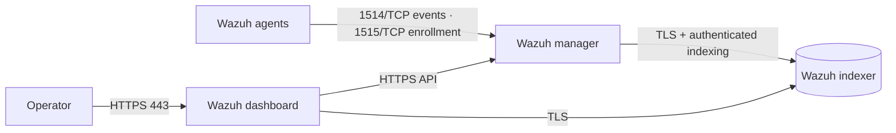
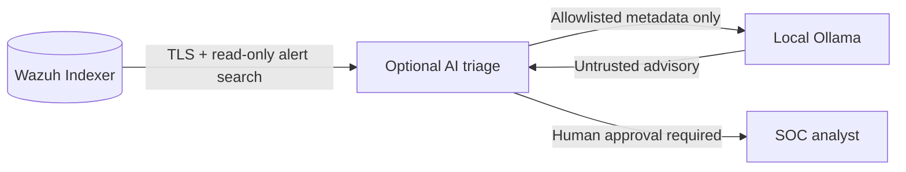

# Wazuh Docker · Single-node deployment

[](https://github.com/redoracle/wazuh/actions/workflows/ci.yml)
[](https://github.com/wazuh/wazuh-docker/releases/tag/v4.14.9)
[](LICENSE)

A reproducible, certificate-backed [Wazuh](https://wazuh.com/) deployment for a single Docker host. It combines the **Wazuh manager, indexer, and dashboard**, aligned to the official **v4.14.9 stable release**. The project adds unique first-run credentials, scoped host ports, automated configuration checks, and practical operations documentation.

> **Scope:** Single-node installation for development, evaluation, and controlled small deployments. This project is independently maintained and is not an official Wazuh release. A single node has no high availability; production readiness depends on your network controls, monitoring, backups, and tested recovery. See [Security](SECURITY.md) and [Architecture](docs/ARCHITECTURE.md).

## Architecture



All three services share a private project-managed Docker bridge network. The indexer has **no published host port**. The dashboard, manager API, and agent ports bind to `127.0.0.1` by default; any external access must be explicitly configured and protected. Durable state is held in Docker named volumes. TLS certificates are generated using Wazuh's release-matched certificate tool.

## Prerequisites

| Requirement | Minimum |
| --- | --- |
| Host | Linux (recommended), Docker Desktop with Linux containers also supported |
| CPU | 4 cores |
| RAM | 8 GB |
| Disk | 50 GB available for images and persisted data |
| Runtime | Current Docker Engine/Desktop and Docker Compose v2 |
| Bootstrap | Python 3.11+ with `pip` |

On Linux, the indexer requires `vm.max_map_count` of at least `262144`:

```bash
sudo sysctl -w vm.max_map_count=262144
```

Persist this host setting according to your operating system's sysctl configuration. For current supported platforms and requirements, refer to the [official Docker deployment guide](https://documentation.wazuh.com/current/deployment-options/docker/wazuh-container.html).

## Quick start

The commands below are for a **new installation with empty volumes**. Never run them against an existing deployment without a migration and recovery plan.

```bash
git clone https://github.com/redoracle/wazuh.git
cd wazuh

python3 -m venv .venv
. .venv/bin/activate
python -m pip install -r requirements-bootstrap.txt

# Create unique passwords and service configuration (only on first install).
python scripts/bootstrap.py

# Generate per-service TLS certificates using the official Wazuh tool.
docker compose -f generate-indexer-certs.yml run --rm generator

# Validate locally; the command does not start containers.
docker compose config --quiet

# Start the three release-matched services.
docker compose up -d
docker compose ps
```

Open **https://localhost** and authenticate with username **`admin`** and the unique `INDEXER_PASSWORD` stored in your private `.env` file. Self-signed certificates require an explicit browser trust decision; use certificates from a trusted CA for public-facing deployments. Initial startup can take several minutes.

The initializer creates `.env` with permissions `0600`, a protected `config/generated/` directory, a unique `authd.pass` enrollment secret, indexer user hashes, an API configuration, and a generated manager configuration. **Existing deployments require an explicit enrollment conversion** before recreating the manager; a checkout never rotates running service credentials. See [agent enrollment](docs/AGENT_ENROLLMENT.md). **Never commit, paste into logs, or share these files.** Re-running the initializer does not rotate existing passwords. See [Credential management](docs/DEPLOYMENT.md#credentials-and-certificates).

## Configuration

Edit `.env` after first-run initialization, then recreate affected services as appropriate. No container images or sensitive secrets are committed to this repository.

| Variable | Default | Description |
| --- | --- | --- |
| `DASHBOARD_BIND_ADDRESS` | `127.0.0.1` | Host interface for dashboard HTTPS on port `443` |
| `AGENT_BIND_ADDRESS` | `127.0.0.1` | Host interface for agent traffic and enrollment on TCP `1514`/`1515` |
| `API_BIND_ADDRESS` | `127.0.0.1` | Host interface for manager API on TCP `55000` |
| `INDEXER_PASSWORD` | Generated | Wazuh indexer `admin` account and manager/dashboard indexer connection |
| `DASHBOARD_PASSWORD` | Generated | Internal `kibanaserver` service credential |
| `API_PASSWORD` | Generated | Wazuh dashboard-to-manager API credential |

**Do not** expose the management API or enrollment ports directly to the public Internet. To connect remote agents, bind to an appropriate private/LAN interface and enforce host firewalls, VPN/TLS and enrollment controls. The indexer must remain accessible only on the Docker network. See [Deployment](docs/DEPLOYMENT.md).

## Daily operations

```bash
make status   # container status
make logs     # follow Wazuh service logs
make test     # offline repository contract tests
make config   # validate the effective Compose model
make docs-check  # offline Markdown links and headings
# After certificate generation, on the deployment host:
make cert-check  # verify TLS trust, key pairs, expiry and key modes (OpenSSL required)
make down     # stop without deleting persistent volumes
```

The `Makefile` provides `bootstrap`, `certs`, `up`, and validation tasks. **Never run `docker compose down -v` without a verified recovery plan**; removing volumes deletes the stored Wazuh state. For backups, incident recovery and configuration management, see [Operations](docs/OPERATIONS.md) and the [recovery runbook](docs/BACKUP_RESTORE.md).

## P0/P1 security controls and acceptance

New installations use password-authenticated Wazuh agent enrollment and disk watermarks, but these security-sensitive changes must be tested in staging before rollout to existing service volumes. Follow [agent enrollment](docs/AGENT_ENROLLMENT.md), [disk protections and recovery](docs/DISK_OPERATIONS.md), and [backup and restore](docs/BACKUP_RESTORE.md). The optional [snapshot operator](docs/BACKUP_RESTORE.md) only creates/verifies alert snapshots against an approved off-host repository; it is **not** complete disaster recovery. Full recovery still needs manager, certificates and credentials, an encrypted off-host backup and a rehearsed restore.

The [multi-host HA migration reference](docs/HA_MIGRATION.md) validates failure-domain inventory design against the official pinned multi-node version; it does **not** deploy high availability automatically. [Supply-chain safeguards](docs/SUPPLY_CHAIN.md) include scheduled vulnerability scans, but deployment still needs immutable image approvals and GitHub [branch rules](docs/REPOSITORY_ADMIN.md). The [monitoring runbook](docs/MONITORING.md) and [production acceptance](docs/PRODUCTION_ACCEPTANCE.md) record remain mandatory.

## Optional AI-assisted security operations

The platform supports an **opt-in, read-only local AI triage workflow** for SOC analysts. It queries a strictly bounded subset of Wazuh Indexer alerts with a separately permissioned identity, projects only minimal non-raw metadata, and can optionally ask a private **Ollama** model to produce investigation hypotheses. All model output is marked **untrusted** and requires analyst verification. No model can execute commands, call the Wazuh Manager API, change security policies, quarantine agents or invoke active response.



**Start offline** with the [AI integration HOWTO](docs/AI_HOWTO.md), then configure a dedicated restricted Indexer principal before enabling the optional Docker overlay (`docker-compose.ai.yml`). No AI service is enabled by a normal `docker compose up -d`. Local model inference is explicitly opt-in, and the Indexer and Ollama have no new host-published ports.

Research-backed guidance: [evaluation and options](docs/AI_INTEGRATIONS.md) · [setup/how-to](docs/AI_HOWTO.md) · [AI threat model](docs/AI_SECURITY.md) · [validation and runbook](docs/AI_VALIDATION.md).


## Enterprise self-hosted readiness

**This is a controlled single-host reference, not a certified enterprise high-availability deployment.** The official multi-node Wazuh architecture must be evaluated for workloads requiring redundant Indexers and Managers. Source-level CI does not prove agent ingestion, recovery, or security posture on a real host.

The repository includes read-only deployment policy checks and an explicit production decision record:

```bash
python -m pip install -r requirements-dev.txt
make preflight
python scripts/enterprise_preflight.py --profile controlled --host
# Expected to fail until deployment-specific HA, backup and security gates are resolved:
python scripts/enterprise_preflight.py --profile enterprise --json
```

Before production approval, follow [enterprise readiness](docs/ENTERPRISE_READINESS.md), the [staging acceptance protocol](docs/PRODUCTION_ACCEPTANCE.md), and the [supply-chain policy](docs/SUPPLY_CHAIN.md). A successful controlled preflight is **not** an enterprise readiness certificate.

For actionable host procedures, use the [agent enrollment security](docs/AGENT_ENROLLMENT.md), [backup and recovery](docs/BACKUP_RESTORE.md) and [TLS certificate lifecycle](docs/CERTIFICATE_OPERATIONS.md) runbooks. These are operator actions; none of them is silently executed by the repository's CI.

## Quality and release management

Pull requests run the Python test suite on 3.11, 3.13 and 3.14, including **real loopback HTTPS contracts and temporary X.509 certificate/key fixtures**, and inspect the **effective, interpolated** Docker Compose model for unsafe exposure or AI network attachment. No Wazuh images are pulled or started in PR CI; local protocol tests do **not** verify a live Wazuh installation. See [Testing and release evidence](docs/TESTING.md) for the test tiers, commands, CI boundaries and staging acceptance criteria. Host certificate verification remains a separate operator check.

Images are intentionally **pinned as a coordinated set to v4.14.9**. Changing the tag alone is not an upgrade plan: Wazuh releases may require matching configuration, certificates and index/data migrations. Follow [Upgrading](docs/UPGRADING.md) and the [official Docker upgrade guide](https://documentation.wazuh.com/current/deployment-options/docker/upgrading-wazuh-docker.html).

## Documentation

| Guide | Contents |
| --- | --- |
| [Deployment](docs/DEPLOYMENT.md) | Prerequisites, credentials, certificates and first startup |
| [AI integrations](docs/AI_INTEGRATIONS.md) | Comparison of official, MCP, local Ollama and orchestration approaches |
| [AI HOWTO](docs/AI_HOWTO.md) | Safe offline demo, Indexer reader role and optional local-model operations |
| [AI security](docs/AI_SECURITY.md) | Trust boundaries and threat model |
| [AI validation](docs/AI_VALIDATION.md) | CI coverage, operator acceptance and rollback |
| [Architecture](docs/ARCHITECTURE.md) | Components, TLS, networks, ports and persistence |
| [Operations](docs/OPERATIONS.md) | Health checks, backups, restore and troubleshooting |
| [Agent enrollment security](docs/AGENT_ENROLLMENT.md) | Authenticated enrollment, source allowlists, change control and negative tests |
| [Backup and restoration](docs/BACKUP_RESTORE.md) | Snapshot repositories, protected volumes and isolated recovery rehearsals |
| [Certificate lifecycle](docs/CERTIFICATE_OPERATIONS.md) | CA validation, SANs, private-key permissions and staged rotation |
| [Upgrading](docs/UPGRADING.md) | Version alignment, maintenance and migration procedure |
| [Security](SECURITY.md) | Threat surface and vulnerability reporting |
| [Enterprise readiness](docs/ENTERPRISE_READINESS.md) | Reliability gaps, security posture and production promotion gates |
| [Staging acceptance](docs/PRODUCTION_ACCEPTANCE.md) | Live environment checklist and signed verification |
| [Testing and validation](docs/TESTING.md) | Deterministic local tests, TLS protocol checks, effective Compose verification and staging gates |
| [Supply chain](docs/SUPPLY_CHAIN.md) | Image provenance, dependency policy and release monitoring |
| [Contributing](CONTRIBUTING.md) | Development workflow and quality standards |
| [Support](SUPPORT.md) | Support boundaries and troubleshooting resources |
| [License](LICENSE) / [Notice](NOTICE.md) | Licensing and upstream attribution |

Upstream sources: [Wazuh Docker v4.14.9](https://github.com/wazuh/wazuh-docker/tree/v4.14.9/single-node) and [official Wazuh documentation](https://documentation.wazuh.com/current/). Container products and the Wazuh trademark belong to their respective owners.
