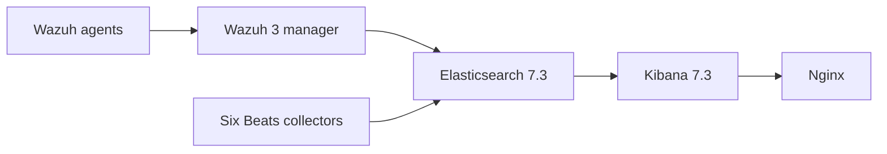

# Wazuh legacy Docker Compose deployment

[CI workflows](https://github.com/redoracle/wazuh/actions/workflows/validate.yml) · [Second audit](docs/SECOND_AUDIT.md) · [Security policy](SECURITY.md) · [Official Wazuh Docker](https://github.com/wazuh/wazuh-docker)

> [!CAUTION]
> **Historical reference — not a supported or production-ready deployment.**
> This repository contains a 2019 Wazuh 3 / Elasticsearch–Kibana 7 / Elastic
> Beats 7.4 Docker Compose configuration. Its images are obsolete, it requests
> substantial host privileges, and its data mounts have not been proven to
> persist application state. **Do not expose or deploy it on untrusted hosts.**
> For a new installation, start with the
> [official Wazuh Docker project](https://github.com/wazuh/wazuh-docker).

A compatibility-preserving maintenance project for an existing ten-container
stack. The purpose of this repository is to make the historical configuration
**auditable, testable, and migratable**—not to present it as a modern Wazuh
reference architecture.

| At a glance | Details |
| --- | --- |
| **Components** | Wazuh manager, Elasticsearch, Kibana, Nginx, and six Elastic Beats collectors |
| **Version baseline** | Wazuh images `3.10.2_7.3.2`; Beats `7.4.2` |
| **Configuration** | [`docker-compose.yml`](docker-compose.yml) with two image-tag families |
| **Network** | Pre-existing `sll_net` and fixed `172.13.0.101–110` container IPs (not private address space) |
| **Verification** | Python contract/docs tests and Docker Compose model validation; **no integration tests** |
| **Production status** | **Unsupported; migration required** |

## Contents

- [Architecture and risks](#architecture-and-risks)
- [Validate without running containers](#validate-without-running-containers)
- [Existing operators: lab-only preflight](#existing-operators-lab-only-preflight)
- [Configuration reference](#configuration-reference)
- [What is and is not verified](#what-is-and-is-not-verified)
- [Documentation and contributions](#documentation-and-contributions)
- [Security and release decisions](#security-and-release-decisions)

## Architecture and risks



This is a *conceptual* dependency sketch; real event routing and security
settings depend on legacy images and host-mounted configuration not stored
here. See the [service inventory and design constraints](docs/ARCHITECTURE.md).

Four critical issues must not be obscured by successful static checks:

1. **Obsolete images.** A Wazuh 3 → current manager/indexer/dashboard transition
   is a platform migration, not an image-tag bump.
2. **Public-range addressing.** `172.13.0.0/16` is **not** RFC1918 space. The
   external Docker network may clash with host routing and neighboring services.
3. **Host-level access.** Collectors use root, Linux capabilities, host PID
   access, and Docker socket mounts. A `:ro` Docker socket bind does *not*
   prevent operations through the socket.
4. **Unproven durability.** Several historical bind mounts target `/Datak`;
   these are not verified application data directories. A running container
   does not prove that data survives recreation or disaster recovery.

Read the [security boundaries](SECURITY.md) before any operational action.

## Validate without running containers

**Prerequisites:** Python 3.11+ and `pip`; for the complete check also install
Docker with the **Compose v2 CLI plugin**. These commands do not pull images,
create containers, or modify the external Docker network.

```sh
python -m pip install -r requirements-dev.txt
make lint             # Compile test/validator Python without execution
make test             # Python/YAML/service-security/documentation contracts
make compose-check    # Docker Compose syntax only; no containers run
make resolved-check   # Validate the interpolated security contract; no containers
# or, to run all four:
make check
```

Without `make`, run the equivalent commands directly:

```sh
python -m unittest discover -s tests -v
docker compose -f docker-compose.yml config --quiet
# The resolved security check is supplied by make resolved-check.
```

GitHub Actions runs offline tests on Python **3.11, 3.13 and 3.14**, plus
two independent Compose checks, for every pull request and push to `master`.
It uses read-only repository permissions, immutable action SHAs, and a
fixed Ubuntu runner baseline. No images or containers are pulled or started.
The test dependency is used by the repository tooling **only**, not installed
inside the Wazuh containers.

## Existing operators: lab-only preflight

> [!WARNING]
> These steps are for assessing an **already existing, isolated deployment**,
> not for creating a new internet-facing stack. Review the detailed
> [operator runbook](docs/OPERATIONS.md) and [migration plan](docs/UPGRADE.md)
> before making changes.

1. Inventory host/container versions, actual image digests, privileged mounts,
   persistent data paths, and a working restore procedure.
2. Check `docker network inspect sll_net` against local routing. **Do not
   recreate the historical public-address subnet on a production host.**
3. Verify all necessary `/DATA/Wazuh` paths and collector configuration files
   are present. Do not infer that a `/Datak` volume persists application data.
4. In a **private, access-controlled lab**, copy `.env.example` to `.env` and
   restrict its permissions (`chmod 600 .env`). Supply actual credentials only
   through your approved secret-management process. Keep them out of Git,
   tickets and CI output.
5. Validate the resolved model with `make check`, then follow the runbook's
   explicit go/no-go checklist. Do **not** treat a successful Compose check as
   approval to run these obsolete images.

## Configuration reference

| Setting | Default / location | Notes |
| --- | --- | --- |
| `WAZUH_STACK_TAG` | `3.10.2_7.3.2` | One coordinated tag for all four legacy Wazuh images; **not** a general upgrade switch |
| `BEATS_TAG` | `7.4.2` | One tag for all six Beats images; changing it needs integration checks |
| `NGINX_CREDENTIALS` | Unset | Historical image environment input; handle as secret and confirm expected format |
| `sll_net` | Existing external network | Fixed IPs require matching IPAM and non-conflicting routing |
| `/DATA/Wazuh/*` | Host bind mounts | Historical paths retained; actual data persistence **unverified** |

The Compose file uses `${VARIABLE:-default}` substitutions, so its original
image tags remain unchanged when `.env` is absent. `.env` is ignored by Git.
The old `expose:` entries do **not** publish host ports; other members of
`sll_net` may nevertheless reach those container endpoints.

## What is and is not verified

| Check | Coverage |
| --- | --- |
| YAML mapping correctness and duplicate keys | Automated unit tests |
| Original service, images, IPs, privilege and mount contracts | Automated unit tests |
| Documentation links and repository hygiene | Automated unit tests |
| Docker Compose model and variable interpolation | GitHub Actions + `make compose-check` |
| Resolved service, image, mount, port and privilege invariants | GitHub Actions + `make resolved-check` |
| Old image availability, CVEs, TLS, secrets, data durability | **Not verified** |
| Detection, ingest, dashboards, recovery, production security | **Not verified**; requires isolated staging |

The [upgrade decision](docs/UPGRADE.md) records why no image version was
changed without a vendor-supported migration path and acceptance tests.

## Documentation and contributions

| Document | Purpose |
| --- | --- |
| [Second engineering audit](docs/SECOND_AUDIT.md) | Prioritized findings, safe upgrades, outstanding critical risks and evidence |
| [Threat model](docs/THREAT_MODEL.md) | Assets, trust boundaries and attack scenarios |
| [Repository settings](docs/REPOSITORY_ADMIN.md) | Required GitHub branch rules, check names and admin checklist |
| [Architecture](docs/ARCHITECTURE.md) | Topology, fixed addressing, host privileges and constraints |
| [Operations](docs/OPERATIONS.md) | Non-destructive preflight, diagnostics, backup and rollback checklist |
| [Upgrade strategy](docs/UPGRADE.md) | Version decisions, migration stages and acceptance gates |
| [Security policy](SECURITY.md) | Known risks and responsible vulnerability reporting |
| [Architecture decision](docs/decisions/0001-legacy-compatibility.md) | Why this PR preserves the legacy contract |
| [Contributing](CONTRIBUTING.md) | Required checks, review rules and change classification |
| [Support](SUPPORT.md) | Scope, limitations and safe issue reporting |
| [Code of conduct](CODE_OF_CONDUCT.md) | Collaboration and moderation guidelines |
| [Changelog](CHANGELOG.md) | Repository maintenance history; not upstream image releases |

Contributions are welcome, but proposed runtime changes must distinguish
**compatibility-preserving maintenance** from a **breaking platform migration**.
See the [contribution guidelines](CONTRIBUTING.md). The repository's root
[MIT license](LICENSE) covers its repository material; upstream images and
components retain their respective licenses.

## Security and release decisions

The [second audit](docs/SECOND_AUDIT.md) records **critical open findings**
that a test suite cannot fix: unsupported vendor images, globally routable
network addresses, host-level collectors and unproven restore capability.
The [threat model](docs/THREAT_MODEL.md) describes these trust boundaries.

**Version policy:** PyYAML 6.0.3 is the latest stable test-only dependency
verified at the audit date, and GitHub Actions are pinned to reviewed release
SHAs. Python CI coverage now includes 3.14. **No legacy Docker image is
upgraded:** Wazuh 3/Elastic 7 to current Wazuh manager/indexer/dashboard is a
separate, vendor-supported migration with data and rollback testing.

The [GitHub settings checklist](docs/REPOSITORY_ADMIN.md) documents branch
protection, required checks, secret scanning and code review controls that
need an administrator to enable; committing a policy file alone cannot
enforce those account-level settings.
