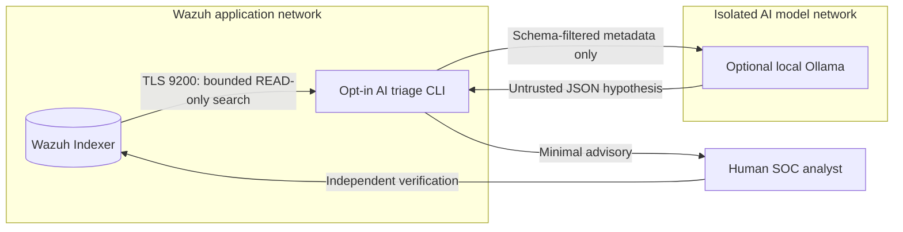

# Wazuh + AI security architecture and threat model

## Data flow and boundaries

- The Wazuh Manager API and active response framework **are not used**.
- The model does **not** query Wazuh, choose arbitrary tools, create a query, or make network requests back to the manager. `ai-ollama` does not share the Wazuh application network.
- The bridge worker does share both networks and is a sensitive boundary; harden the Docker host, restrict network egress and use a dedicated reader principal. The Ollama service itself may reach external resources for image/model downloads unless firewall policies restrict it. Avoid assuming “local” automatically means air-gapped.
- Wazuh cannot prevent compromise by a Docker administrator; the reader password is mounted into the worker. Protect Docker access and use rootless/user-namespace isolation and external network policy where appropriate and tested. The example is not a formal isolation guarantee.

## Threats and controls

| Threat | Mitigation | Remaining risk |
| --- | --- | --- |
| Prompt injection in alert `full_log`, message, filenames, usernames | Raw fields never reach the model; only schema-validated numeric/tokenized metadata is forwarded; system prompt declares data untrusted | Numeric/group token abuse, hallucination, malicious text in model output |
| Privileged LLM decides to delete/quarantine/restart | No write endpoints, tools, manager tokens, active response hooks or socket; only `POST /_search` with a predefined query | Analyst might manually follow poor advice; require human approval |
| Wazuh/indexer credential theft | Dedicated read-only role, separate user, local password file, TLS root CA validation, no credentials in audit | Container/host admins and root processes can still access mounted secret |
| SSRF / model data exfiltration | Hardcoded local endpoint hostname/port allowlists, disabled environment proxies/redirects, no hosted model plugin | OS or container compromise can bypass CLI policy; enforce egress ACLs |
| Oversized/recursive queries, denial of service | Fixed alert index pattern, query size 1–50, short date window, severity filter, no pagination/scroll or arbitrary DSL | Query performance still varies with index load; observe host resource pressure |
| Oversized/model-malformed output | Hard response byte limits, structured JSON validation, string length/array caps, control-character removal | Output may be confidently incorrect or still contain misleading advice |
| Privacy leakage through logs | Run audit contains counts and status only; per-run HMAC pseudonyms; model receives no raw events | Final terminal/redirected reports contain metadata that may still be sensitive; protect and delete per retention policy |
| Supply-chain compromise | Base Wazuh stays version-matched; opt-in AI runtime image and model must be approved and scanned | Container image tags alone are not immutable digests; validate before production |
| Accidental AI deployment | Optional Compose profile/overlay and explicit `--ollama`; base `docker compose up` unaffected | An operator may explicitly run an opt-in service inadvertently |

## Operating rules

1. **Least privilege is enforced in the Indexer, not trusted to the client.** Grant the AI account only the `search` action group for intended alert indices; this is narrower than OpenSearch's `read` group, but still allows the principal to search raw alert documents if field-level restrictions are absent. The example uses `wazuh-alerts-4.x-*` and no cluster/tenant permissions. Test denial of writes and reading unrelated indices before acceptance.
2. **No automatic operational action.** This repo will not translate model output into shell commands, manager API actions, network blocks, agent restarts or incident changes. Human decisions follow documented change controls.
3. **Local and opt-in.** The included worker calls only the Wazuh Indexer and an explicitly enabled local Ollama endpoint. Neither the model nor the Indexer publishes new host ports in this overlay; enforce firewall and container egress policy independently.
4. **Validate transport.** The worker refuses plaintext Indexer HTTP and HTTPS with an untrusted/self-signed CA; it requires the generated trusted root CA. It rejects URL credentials, query strings and redirects.
5. **Retention and compliance.** Do not forward reports to unapproved destinations. Protect `local-state` and `local-secrets` (mode 0700 for directories, 0600 for files); rotate the dedicated Indexer password through its supported runtime security management process.
6. **Read-only is not read-safe.** Some alerts contain attacker-authored content. Prompt injection is mitigated by projection and tool-free inference, not eliminated. Analysts must independently validate all conclusions.

## Integration scope and change control

This repository does not include an MCP server, remotely hosted model gateway or autonomous agent framework. These integrations have not been exercised against this Wazuh Docker stack and must not be presented as validated capabilities. Any future integration must undergo independent authentication, privilege, tool-inventory, data-egress and version-specific tests before becoming an operator-facing feature.

References: [OpenSearch role API](https://docs.opensearch.org/latest/security/api/roles/create-role/), [OpenSearch permission groups](https://docs.opensearch.org/latest/security/access-control/default-action-groups/), and [Wazuh Indexer API](https://documentation.wazuh.com/current/user-manual/indexer-api/reference.html).
