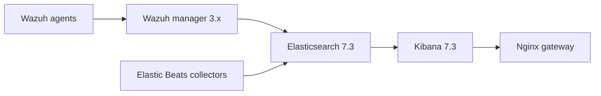

# Legacy architecture and operational contracts

## Data flow (conceptual)

This diagram is conceptual. Actual Beat outputs, TLS settings, and integration
routes depend on external configuration files and the old images, which are not
included in this repository. None of those connections is runtime-tested here.

| Service | Address | Original image/version | Sensitive dependency |
| --- | --- | --- | --- |
| nginx | 172.13.0.101 | wazuh/wazuh-nginx:3.10.2_7.3.2 | NGINX_CREDENTIALS |
| kibana | 172.13.0.102 | wazuh/wazuh-kibana:3.10.2_7.3.2 | /DATA/Wazuh/Kibana |
| elasticsearch | 172.13.0.103 | wazuh/wazuh-elasticsearch:3.10.2_7.3.2 | /DATA/Wazuh/Elasticsearch, 1 GiB heap |
| wazuh | 172.13.0.104 | wazuh/wazuh:3.10.2_7.3.2 | Manager ports |
| packetbeat | 172.13.0.105 | docker.elastic.co/beats/packetbeat:7.4.2 | NET_RAW, NET_ADMIN |
| filebeat | 172.13.0.106 | docker.elastic.co/beats/filebeat:7.4.2 | root, container logs, Docker socket |
| auditbeat | 172.13.0.107 | docker.elastic.co/beats/auditbeat:7.4.2 | host PID, AUDIT_CONTROL/READ |
| journalbeat | 172.13.0.108 | docker.elastic.co/beats/journalbeat:7.4.2 | Host journal and machine identity |
| heartbeat | 172.13.0.109 | docker.elastic.co/beats/heartbeat:7.4.2 | /DATA/Wazuh/Heartbeat |
| metricbeat | 172.13.0.110 | docker.elastic.co/beats/metricbeat:7.4.2 | root, Docker socket, hostfs, SYS_PTRACE |

### Current constraints

**Network.** `sll_net` is an externally managed Docker network. The fixed
addresses must exist within its IPAM subnet and be free. `172.13.0.0/16` is
**not** RFC1918 space; prefer a private network and service-name DNS in a future
breaking redesign. A Docker `expose` entry is not an external port mapping.

**Storage.** Several host directories are mounted to `/Datak`, which may be an
incorrect destination for the image. No application data-path validation is
possible from the repository alone. A successful container start is not proof
of durable indexing or backups.

**Readiness.** `depends_on` provides startup ordering, not application
readiness. No health checks are defined. A successful `docker compose config`
only verifies the Compose model, not service availability, TLS, credentials,
or data integrity.

**Resources.** Elasticsearch is limited to 2 GiB container RAM with a 1 GiB
JVM heap. The capacity and memory headroom must be verified under real load.

**Privilege.** Packetbeat, Auditbeat, Filebeat and Metricbeat require
additional host capabilities, access, or namespaces. The Docker socket
mount remains powerful even with `:ro`. See [SECURITY.md](../SECURITY.md).

### Architecture improvement backlog

For a **separate migration**, use official Wazuh manager, indexer and dashboard
images and vendor-managed certificates/credentials. Apply a private network
plan, remove fixed IPs where possible, adopt verified named volumes and snapshot
backups, segregate collectors with minimum rights, remove Docker socket mounts
when not strictly necessary, and add checks that exercise actual ingest,
alerting, health, retention, dashboard login, and recovery.

For inspection and recovery without destructive changes, use the
[operator runbook](OPERATIONS.md). Major compatibility decisions are documented
in [ADR 0001](decisions/0001-legacy-compatibility.md).

Reference: https://github.com/wazuh/wazuh-docker
